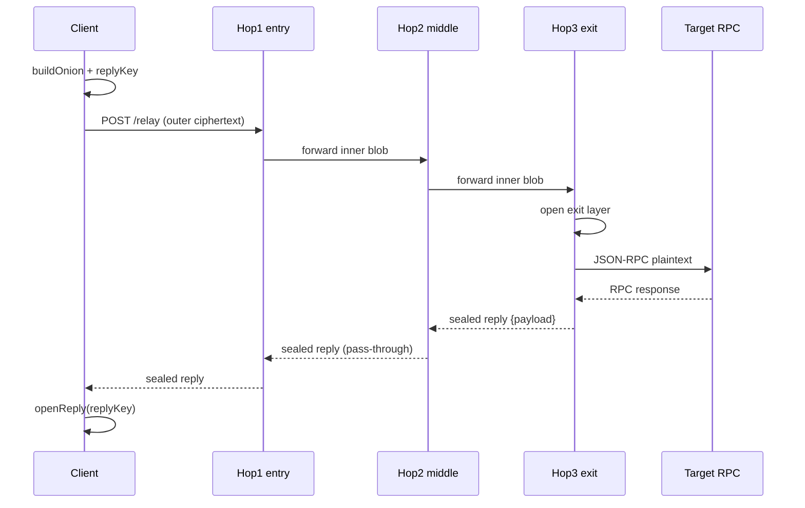

# Relay Mesh

**Live demo:** https://relay-mesh-zeta.vercel.app

**Judge quickstart:** [live demo](https://relay-mesh-zeta.vercel.app) · [hop1 /health](https://hop1-production-70b7.up.railway.app/health) · [Sepolia specifier](https://sepolia.etherscan.io/address/0x005d62b2fB2BbfB05d268990DA6c328F80de28D1) · [Use it with Anon-RPC](#use-it-with-anon-rpc)

Relay Mesh is a **3-hop onion-routed relay network** for private JSON-RPC calls. No single relay ever sees both the client's network identity **and** the plaintext query.

- **Clients** build the onion in-browser or in Node (`x25519` + `XChaCha20-Poly1305`) and talk only to the entry hop.
- **Relays** peel one layer and forward content-addressed ciphertext; the exit sees the RPC but not the original client IP. The reply is sealed so entry/middle only see ciphertext.
- **Operators** run hops under **independent Railway accounts** so billing and control are not a single project login.
- **Anon-RPC hosts** can pin the published worker by hash via an on-chain specifier.

## Live

| | |
|---|---|
| Demo | https://relay-mesh-zeta.vercel.app |
| Hop 1 (entry) | https://hop1-production-70b7.up.railway.app |
| Hop 2 (middle) | https://hop2-production.up.railway.app |
| Hop 3 (exit) | https://hop3-production.up.railway.app |
| Hop 4 (spare) | https://hop4-production.up.railway.app |
| Circuit registry | [`circuit-registry.json`](./circuit-registry.json) |
| Worker resolver | [keccak path](https://raw.githubusercontent.com/KartikDehru/Relay-mesh/keccak/f9/85be89550e8fea776ff7a88a470b114a0420bdc3a204c1a21239dc117a2154) |

Health check any hop: `GET /health` → `{ role, fingerprint, publicKey, version, commit }`.

Fixed MVP circuit: **hop1 → hop2 → hop3**. Hop 4 is a live spare; hop 5 is reserved.

## Use it with Anon-RPC

Relay Mesh is published as an Anon-RPC worker, so any wallet or app that supports the Anon-RPC standard can route its JSON-RPC reads through the 3-hop mesh by pointing at our specifier contract — no Relay Mesh-specific code.

### Where it fits

- **Wallets:** balance and token lookups without the RPC provider linking your IP to your addresses.
- **dApps:** read calls (`eth_call`, `eth_getBalance`, logs) from the browser.
- **Bots and AI agents:** queries that would otherwise reveal a strategy.
- **Any Anon-RPC harness**, including the [official demo page](https://ethereum.github.io/anon-rpc/demo/) (steps below).

### Try it in the official Anon-RPC demo

Open [https://ethereum.github.io/anon-rpc/demo/](https://ethereum.github.io/anon-rpc/demo/):

1. **Worker** → `Custom — paste a specifier`.
2. **Bootstrap RPC URL** → `https://ethereum-sepolia-rpc.publicnode.com`.
3. **Worker RPC URL** → click **use same**.
4. **Specifier contract** → `0x005d62b2fB2BbfB05d268990DA6c328F80de28D1`.
5. **Worker config** → leave blank (defaults to hop1 → hop2 → hop3).
6. **Address** → any Sepolia address (e.g. `0xd8dA6BF26964aF9D7eEd9e03E53415D37aA96045`).
7. Click **Start watching**.

Confirmed: balance loads through the sandboxed worker (`eth_getBalance OK`).

### Integrate in a wallet or dApp

Install `@anon-rpc/browser-harness` and point it at our Sepolia specifier (same shape as the [Anon-RPC wallet Quick start](https://ethereum.github.io/anon-rpc/wallets/)):

```ts
import { AnonRpcWorker } from "@anon-rpc/browser-harness";

const SEPOLIA_RPC = "https://ethereum-sepolia-rpc.publicnode.com";
const RELAY_MESH_SPECIFIER = "0x005d62b2fB2BbfB05d268990DA6c328F80de28D1";

/** Minimal EIP-1193 wrapper over fetch for the one-time specifier bootstrap read. */
const sepoliaBootstrap = {
  request: async ({ method, params }: { method: string; params?: unknown }) => {
    const res = await fetch(SEPOLIA_RPC, {
      method: "POST",
      headers: { "content-type": "application/json" },
      body: JSON.stringify({ jsonrpc: "2.0", id: 1, method, params: params ?? [] }),
    });
    const body = (await res.json()) as { result?: unknown; error?: { message?: string } };
    if (body.error) throw new Error(body.error.message ?? "RPC error");
    return body.result;
  },
};

const worker = new AnonRpcWorker({
  // Specifier contract on Sepolia (reference adopters use mainnet).
  address: RELAY_MESH_SPECIFIER,
  // Optional — see Worker config below. Leave undefined for hop1 → hop2 → hop3.
  config: undefined,
  preExisting: {
    rpcProvider: sepoliaBootstrap,
  },
});

const res = await worker.fetch(SEPOLIA_RPC, {
  method: "POST",
  headers: { "content-type": "application/json" },
  body: JSON.stringify({
    jsonrpc: "2.0",
    id: 1,
    method: "eth_getBalance",
    params: ["0xd8dA6BF26964aF9D7eEd9e03E53415D37aA96045", "latest"],
  }),
  // Optional: our worker picks a stable 3-hop circuit per key from the hop pool.
  anonOptions: { isolationKey: "account-1" },
});
const { result } = await res.json();

// worker.fetch can be passed to anything that accepts a custom fetch.
worker.close();
```

### Worker config

Optional plain JSON delivered as `WorkerInit.config` (see [`packages/anon-rpc-worker/README.md`](./packages/anon-rpc-worker/README.md)):

```json
{
  "hops": [{ "id": "hop1", "url": "https://…", "publicKey": "…" }, …],
  "pool": [{ "id": "hop4", "url": "https://…", "publicKey": "…" }, …],
  "honorIsolationKey": true
}
```

Defaults bake in the live hop1→hop2→hop3 Railway circuit. When `anonOptions.isolationKey` is set and `honorIsolationKey` is true, the worker deterministically picks 3 hops from `pool`.

### Good to know

- The specifier is on Sepolia; the bootstrap provider must be able to read Sepolia (Anon-RPC's reference examples use mainnet).
- The live exits only call allowlisted targets — currently `https://ethereum-sepolia-rpc.publicnode.com`. Requests to any other RPC URL are rejected. Mainnet support means adding a mainnet target to `EXIT_RPC_ALLOWLIST`.
- Per the Anon-RPC wallet guide, the one-time bootstrap read of the specifier is not anonymized, and the worker sees every request routed through it, including signed transactions.
- Our worker reaches the entry hop over HTTPS (ambient `fetch`), not Anon-RPC's KPS transport; moving to KPS is future work.

## Verify it yourself

Judges can confirm the live path without trusting this README:

1. Open each hop’s [`/health`](https://hop1-production-70b7.up.railway.app/health) — compare `fingerprint`, `version`, and `commit` (`RAILWAY_GIT_COMMIT_SHA`). Matching `commit` short-hashes across hop1–hop4 means they run the same build.
2. Hit the [live demo](https://relay-mesh-zeta.vercel.app) health strip (shows the short commit next to each hop).
3. Check the [Sepolia specifier](https://sepolia.etherscan.io/address/0x005d62b2fB2BbfB05d268990DA6c328F80de28D1) and recompute the worker keccak (see Tests / on-chain table).

## On-chain (Sepolia)

| | |
|---|---|
| Worker keccak256 | `0xf985be89550e8fea776ff7a88a470b114a0420bdc3a204c1a21239dc117a2154` |
| Specifier | [`0x005d62b2fB2BbfB05d268990DA6c328F80de28D1`](https://sepolia.etherscan.io/address/0x005d62b2fB2BbfB05d268990DA6c328F80de28D1) |
| Deploy tx | [`0x356ed8d5…e7a6ed`](https://sepolia.etherscan.io/tx/0x356ed8d5e2a202533d43d1bc808c66cb9b90d4a63b826afb37ce74a286e7a6ed) |
| Worker update tx | [`0x91a92c4e…2088e0`](https://sepolia.etherscan.io/tx/0x91a92c4e43eb4f057a2be85a34440529e1f12ccd4cd09e42fc0a9a35a12088e0) |
| Metadata | [`packages/anon-rpc-worker/SPECIFIER.json`](./packages/anon-rpc-worker/SPECIFIER.json) |

Harnesses MUST reject any bytes whose `keccak256` does not equal `workerHash()`. Resolver URLs are advisory only.

Relay Mesh is published as a worker bundle at
`0xf985be89550e8fea776ff7a88a470b114a0420bdc3a204c1a21239dc117a2154`,
resolvable via specifier contract
[`0x005d62b2fB2BbfB05d268990DA6c328F80de28D1`](https://sepolia.etherscan.io/address/0x005d62b2fB2BbfB05d268990DA6c328F80de28D1)
(Sepolia).

## Why this network

Anon-RPC leaves the anonymizing network's topology unspecified and does not rule out a single operator seeing both identity and content. Relay Mesh is a concrete multi-hop network for that slot: nested sealed boxes, independent hop operators, encrypted replies, and a hash-pinned worker that plugs into Anon-RPC's own interface.

### Claims & Sources

Cited directly from the standard:

- anon-rpc Specification, §1 (Overview) and §10 (KPS transport): the spec says a
  client "routes requests through an anonymity network" but never defines that
  network's structure. §10 states KPS "provides secure, multiplexed byte streams
  to a peer identified by a certificate hash," and that `remoteAddress` is
  informational and "MUST NOT be treated as authentication" — i.e., KPS secures
  one hop's transport, it is not itself an anonymity mechanism.
  https://ethereum.github.io/anon-rpc/spec/

- anon-rpc Specification, §14 (Security considerations): "Harness authors MUST
  treat worker code as untrusted." The spec names a compromised worker bundle and
  an untrusted distribution source as its only explicit adversaries — it does not
  name a network observer, colluding relays, or a logging RPC endpoint as
  adversaries it defends against.
  https://ethereum.github.io/anon-rpc/spec/

- anon-rpc Integration Guide: Anonymizing Networks: lists "a mixnet, onion
  router, RPC privacy relay" as examples of what can be plugged in, and states
  the hop structure "is up to the network," not the standard. It does not require
  independent operators or multiple hops for a plugged-in network to be accepted.
  https://ethereum.github.io/anon-rpc/networks/

- anon-rpc homepage / architecture overview: describes the worker receiving each
  request's URL and fetch init directly (i.e., the plaintext query), and states
  that `isolationKey` (an option expressing that calls should not be linkable)
  is honored "up to the worker" — the standard gives no guarantee here.
  https://ethereum.github.io/anon-rpc/

- anon-rpc live demo (reference implementation):
  https://ethereum.github.io/anon-rpc/demo/

In short: nothing in the standard requires that no single party sees both the
client's identity and the query content — that property depends entirely on
which network is plugged in. Relay Mesh is built to be that network.

Relay Mesh's worker is pinned on Sepolia; the reference anon-rpc adopters run on mainnet.

## How it works



## Who sees what

| | Client IP | Request content | Response content |
|---|---|---|---|
| Hop1 entry | Yes | No (ciphertext) | No (sealed reply) |
| Hop2 middle | No (sees previous hop) | No (ciphertext) | No (sealed reply) |
| Hop3 exit | No (sees hop2) | Yes | Yes (then seals) |
| Target RPC | No (sees exit) | Yes | Yes |

## Repo

| Path | What |
|---|---|
| [`packages/crypto`](./packages/crypto) | Onion seal/open, reply seal, bucket padding |
| [`packages/relay-node`](./packages/relay-node) | HTTP hop (`POST /relay`, `GET /health`, demo `/whoami`) |
| [`packages/client`](./packages/client) | Node client + registry helpers + integration tests |
| [`packages/demo`](./packages/demo) | Next.js before/after dashboard (Vercel) |
| [`packages/anon-rpc-worker`](./packages/anon-rpc-worker) | Hash-pinned anon-rpc worker + `WorkerSpecifier` |
| [`circuit-registry.json`](./circuit-registry.json) | Public keys + live hop URLs (no private keys) |
| [`docs/`](./docs) | Deploy guide, hackathon notes, AI disclosure |

## Run it

Needs Node ≥ 20 and [pnpm](https://pnpm.io) (via Corepack).

```bash
git clone https://github.com/KartikDehru/Relay-mesh.git
cd Relay-mesh
pnpm install
pnpm test:crypto
pnpm test:integration          # local 3-hop (+ 4-hop)
pnpm test:live                 # live Railway hop1→hop2→hop3
pnpm check-hops
pnpm --filter @relay-mesh/relay-node test
pnpm dev:demo                  # http://localhost:3000
```

## Tests

| Command | Proves |
|---|---|
| `pnpm test:crypto` | Seal/open, replyKey round-trip, bucket padding, N-hop peel, ciphertext ≠ JSON-RPC |
| `pnpm --filter @relay-mesh/relay-node test` | Non-allowlisted forward/exit rejected; HTTPS-only exit targets; upstream timeout → 504; demo `/whoami` + sealed observations against a local mock JSON-RPC (offline) |
| `pnpm test:integration` | Local 3-hop and 4-hop `eth_blockNumber` through sealed replies against an in-process mock JSON-RPC (offline; no public RPC) |
| `pnpm test:live` | Fixed Railway circuit returns a valid block number (`LIVE_CIRCUIT=1`) |
| `pnpm check-hops` | Each registry hop `/health` matches fingerprint |

## Security hardening

- **Encrypted replies** — exit seals status/body with a per-request `replyKey`; entry/middle only forward ciphertext.
- **Hop allowlist** — forward URLs must appear in `ALLOWED_HOP_URLS` or the circuit registry loaded at boot.
- **Exit RPC allowlist** — `EXIT_RPC_ALLOWLIST` maps chain IDs to https URLs; the onion `rpcTargetUrl` must match exactly.
- **Upstream timeouts** — every hop fetch aborts at 10s (default) and returns 504.
- **Rate limiting** — `/relay` is capped per client IP (default 60/min).
- **Bucket padding** — exit plaintext and sealed replies pad to 1/4/16/64 KiB buckets.
- **No plaintext logging** except opt-in demo mode (`DEMO_LOGGING=true` + `x-relay-demo: 1`), which seals per-hop observations to a client `demoKey`.

## Deploy

- **Hops** — independent Railway accounts. See [`docs/deploy.md`](./docs/deploy.md). After hardening, set `ALLOWED_HOP_URLS`, `EXIT_RPC_ALLOWLIST`, and optionally `DEMO_LOGGING=true`.
- **Demo** — Vercel project root `packages/demo` (see `packages/demo/vercel.json`).
- **Worker** — orphan `keccak` branch + Sepolia `WorkerSpecifier` (`packages/anon-rpc-worker`).

## Current limitations

1. **Hop position is inferable** from onion layer size — there are no Sphinx-style constant-size packets yet. Bucket padding reduces *content* size leakage, not hop-position leakage.
2. **Mix delay** is a random per-request delay (`MIX_DELAY_MS_*`), not batch mixing across clients.
3. **Operators** run independent Railway *accounts* but are affiliated with the same team. Stronger decentralization needs unaffiliated operators.
4. **Global passive adversary** watching every hop can still attempt timing correlation.
5. **Exit RPC target** sees the query and response (by design); privacy is against linking that view to the original client IP via a single hop.
6. **Hop 5** is reserved and not deployed yet.
7. **Entry hop over HTTPS, not KPS** — the Anon-RPC worker reaches hop1 with ambient `fetch` over HTTPS. Moving the client→entry leg onto Anon-RPC's KPS transport is future work.

## Hackathon

Built for ETHGlobal Mumbai. First commit: [`40347e7`](https://github.com/KartikDehru/Relay-mesh/commit/40347e7). Notes: [`docs/hackathon.md`](./docs/hackathon.md). AI disclosure: [`docs/AI_USAGE.md`](./docs/AI_USAGE.md).

## License

MIT — see [`LICENSE`](./LICENSE).
